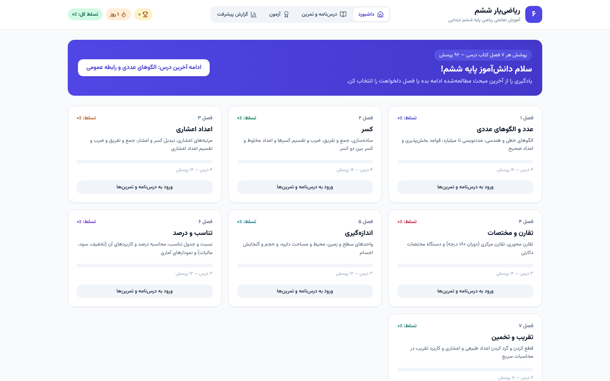
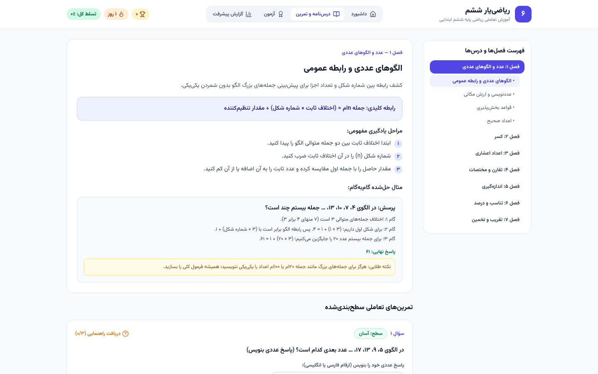
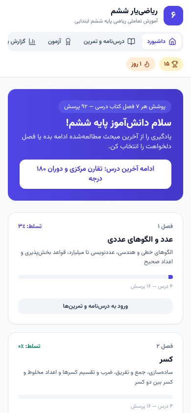
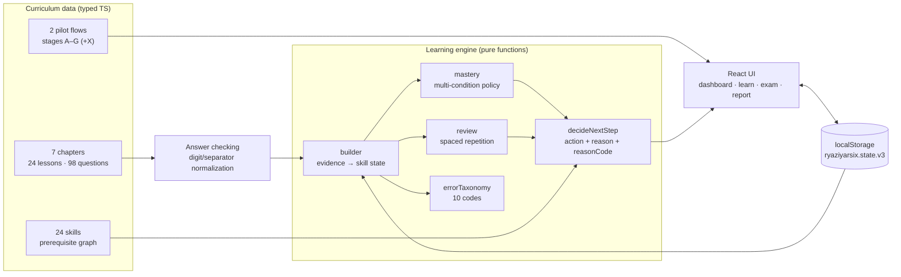

# RYAZI-YAR SIX — ریاضی‌یار ششم

[](https://github.com/aresmaeily2/RYAZI-YAR-SIX/actions/workflows/ci.yml)
[](LICENSE)
[](#testing)

**[English](README.md) | [فارسی](README.fa.md)**

An adaptive, self-study mathematics platform for **sixth-grade elementary
students** (Iranian national curriculum, book code ۶۰۵). Fully Persian and
right-to-left, installable as an offline-first PWA, with an explainable
adaptive learning engine: a prerequisite skill graph, spaced repetition, error
taxonomy, multi-stage lesson flows, diagnostic dashboards and chapter /
comprehensive exams.

> 🌐 **Live app:** https://aresmaeily2.github.io/RYAZI-YAR-SIX/
>
> This project is independent — it shares no code or content with the
> "RIAZI-YAR" first-grade repository; only architecture experience carried over.

| Dashboard | Lesson & adaptive practice | Mobile (390 px) |
|---|---|---|
|  |  |  |

*(Real product screenshots — no mockups. More in
[docs/screenshots/](docs/screenshots/) and
[docs/lesson-ch7l3/](docs/lesson-ch7l3/) covering every stage of the pilot flow.)*

## Target audience

- **Grade:** 6th grade elementary (Iranian curriculum, ages ~11–12).
- **Language:** Persian, full RTL rendering with proper math-island handling
  (Latin digits/operators embedded in Persian text are isolated LTR to keep
  equations readable).
- **Tone:** child-safe — encouraging feedback, no public rankings, no
  humiliating comparisons, an explicit "it's okay to say I don't know" stance.

## Learning methodology

1. **Prerequisite-aware sequencing** — before a lesson, short prerequisite
   checks route the student back to weak foundations instead of forcing them
   through content they can't support yet.
2. **Concrete → pictorial → symbolic** — concepts are introduced with real-life
   scenarios, multiple representations (fraction bars, number lines, place-value
   tables, coordinate planes) and only then symbolic notation.
3. **Worked examples with think-aloud** — each step says *why*, how to *check*
   it, and the *common mistake* to avoid.
4. **Completion problems** — partially solved examples where the student fills
   the missing step, with a graduated hint ladder.
5. **Independent practice, then transfer** — mastery is only credited after a
   hint-free accuracy bar *and* a success on a different-looking (transfer)
   problem *and* a successful delayed review.
6. **Error diagnosis, not just marking wrong** — each wrong MCQ option is tied
   to a known misconception with a concrete remediation suggestion.

## Adaptive learning architecture



### Skill graph & prerequisite system

Every lesson maps 1:1 to a measurable skill (`sk-<lessonId>`,
`src/learning/skills.ts`): 24 skills, 24 prerequisite edges, 4 roots
(`ch1l2`, `ch2l1`, `ch4l1`, `ch4l3`), 7 cross-chapter edges (e.g. decimal place
value requires integer place value *and* fraction basics; percent requires
fractions *and* decimals). The graph is cycle-checked by tests (3-color DFS)
and self-references are rejected.

### Mastery criteria (configurable engineering defaults)

| Condition | Default |
|---|---|
| Independent (hint-free) accuracy | ≥ 0.85 |
| Minimum independent attempts | 4 |
| Distinct success profiles (type × difficulty) | ≥ 2 |
| Transfer assessment | required |
| Delayed review | required |

All five are met → **confirmed mastery**; accuracy + variety only →
**temporary mastery**; otherwise → needs practice. Confidence is displayed as a
weighted ratio of met conditions. ⚠️ These thresholds are **engineering
assumptions, not validated pedagogical constants** — they are centralized in
`MasteryPolicy` (`src/learning/mastery.ts`) and meant to be recalibrated against
real usage.

### Spaced repetition

Simplified Leitner (`src/learning/review.ts`): stages over **[1, 3, 7, 14]**
days. Hint-free success advances a stage, hint-assisted success holds the
stage, failure drops two stages (floor 0). Due reviews surface in the dashboard
queue first.

### Error classification

Ten codes (`src/learning/errorTaxonomy.ts`): `calculation`, `conceptual`,
`place-value`, `wrong-method-context`, `operation-order`, `unit-conversion`,
`problem-reading`, `data-selection`, `diagram-interpretation`, `guessing`.
Blank answers and heavy hint use classify as guessing; each wrong MCQ option
maps to a specific misconception with remediation text. Diagnoses are treated
as **hypotheses** — the dashboard shows the dominant pattern and the parent
report lists per-skill error counts.

### Lesson flow (A–G)

Two **pilot lessons** implement the full instructional flow
(`src/data/flows/`): *Adding & subtracting fractions* (`ch2l2`, stages A–G) and
*Combined operations* (`ch7l3`, stages A,B,C,D,E,X,F,G — adds a step-sequencing
challenge and an animated step solver with playback controls and a
deliberate-mistake mode).

**A** prereq-check (retest + remedial loop) → **B** intuitive intro →
**C** multiple representations → **D** worked example → **E** completion
example → **X** step sequencing (ch7l3) → **F** independent practice →
**G** transfer assessment. Every stage has a pass rule; failure routes to
remediation, never to a dead end. Progress persists — leaving and re-entering
resumes at the right stage.

The other 22 lessons use the **standard tier**: lesson page + optional lab +
adaptive graded practice. This depth difference is stated honestly everywhere
(in [docs/CURRICULUM_COVERAGE.md](docs/CURRICULUM_COVERAGE.md) too).

## Curriculum coverage

Structural coverage of all 7 chapters of the official book:

| Ch | Topic | Lessons | Questions |
|---|---|---|---|
| 1 | Numbers & numeric patterns | 4 | 16 |
| 2 | Fractions | 4 | 16 |
| 3 | Decimals | 4 | 16 |
| 4 | Symmetry & coordinates | 3 | 12 |
| 5 | Measurement | 3 | 12 |
| 6 | Ratio & percent | 3 | 12 |
| 7 | Approximation & estimation | 3 | 14 |
| | **Total** | **24** | **98** (85 MCQ + 13 numeric) |

Plus 25 worked examples and 4 interactive labs (fraction, coordinate, cylinder,
discount simulator). Full per-lesson tables and the honest gap list:
[docs/CURRICULUM_COVERAGE.md](docs/CURRICULUM_COVERAGE.md).

## Technology

- **React 18** + **TypeScript 5** (strict) + **Vite 7**
- **Tailwind CSS 3** with WCAG-AA-checked color tokens
- **Vitest 5** + **Testing Library** (~497 runtime tests)
- Hand-written service worker (`public/sw.js`) — no PWA plugin
- Local **Vazirmatn** font files (no font CDN)
- Runtime dependencies: `react`, `react-dom`, `lucide-react` — nothing else

## Local development

Requires Node.js 18+ (20+ recommended). No environment variables, no API keys,
no accounts — there is no `.env` and none is needed.

```bash
git clone https://github.com/aresmaeily2/RYAZI-YAR-SIX.git
cd RYAZI-YAR-SIX
npm ci            # clean install from the lockfile
npm run dev       # dev server
```

## Testing

```bash
npm run typecheck # tsc -b
npm run lint      # eslint .
npm test          # vitest run — ~497 tests
npm run build     # tsc -b && vite build
```

The suite covers curriculum integrity (unique ids, schema invariants), a
hand-audited **golden master of all 98 answer keys**, ~120 engine scenarios
(mastery transitions, review scheduling, prerequisite cycles, storage
corruption, migration healing), accessibility (per-MCQ accessible names for all
85 MCQs, 24 WCAG contrast pairs, reduced motion), RTL bidi isolation, and flow
paths including failure routes. Details: [docs/TESTING.md](docs/TESTING.md).

## Build

`npm run build` emits a fully static, relative-path site to `dist/`
(`base: './'`), so it works under any subpath without configuration.

## GitHub Pages deployment

`.github/workflows/deploy.yml` deploys on **push to `main` only**: its build job
runs the full test suite and production build first, and the `deploy` job is
gated by `needs: build` — **a failing build can never be published**. Set
Settings → Pages → Source = *GitHub Actions* once. Live site:
https://aresmaeily2.github.io/RYAZI-YAR-SIX/

## Offline support

Installable PWA (RTL/fa manifest, maskable icons). After the first online
visit, the service worker serves the app shell and all assets from cache
(cache-first, same-origin only); bumping `CACHE_NAME` purges old caches. The
app keeps working fully offline — including exams and labs — and stores all
progress locally.

## Privacy

**Privacy by architecture** (verified in [docs/PRIVACY.md](docs/PRIVACY.md)):

- **Zero external network requests at runtime** — the only `fetch` in the
  codebase is the service worker's same-origin cache handler. No analytics, no
  telemetry, no ads, no accounts, no CDN fonts.
- All progress stays in **one localStorage key** on the device
  (`ryaziyarsix.state.v3`).
- **Export** progress as JSON, **import** it back (validated), or **wipe**
  everything — full data lifecycle under the student's/parent's control.
- No collection of children's personal data; the optional student name is
  stored locally only and clamped to 30 characters.

Security policy & reporting: [SECURITY.md](SECURITY.md).

## Limitations (honest)

- Only the 2 pilot lessons implement the full A–G instructional flow; the
  other 22 lessons use the standard lesson + adaptive practice path.
- No user studies or learning-effectiveness claims exist — the dashboard's
  "effectiveness metrics" monitor product usage only.
- Mastery thresholds and review intervals are configurable engineering
  assumptions pending recalibration with real data.
- Question types are MCQ and numeric-entry only (no long-answer grading);
  `toleratedError` is declared but unused.
- Content is independently authored to match the official book's *structure*;
  the textbook itself is not reproduced.

## Contributing

Issues and pull requests are welcome — see
[CONTRIBUTING.md](CONTRIBUTING.md) for the workflow,
[docs/CONTENT_AUTHORING.md](docs/CONTENT_AUTHORING.md) for step-by-step
instructions on adding lessons, questions and flows, and
[CODE_OF_CONDUCT.md](CODE_OF_CONDUCT.md) for community standards. Every PR runs
CI (typecheck, lint, tests, build, dependency audit, secret scan).

## License

[MIT](LICENSE) © 2025 aresmaeily2. The independently-authored educational
content of this repository is part of the MIT-licensed codebase. The official
Iranian textbook belongs to its publisher (پژوهشگاه مطالعات آموزش‌وپرورش) and
is **not** reproduced here.

## Documentation index

| Doc | Content |
|---|---|
| [docs/OPEN_SOURCE_AUDIT.md](docs/OPEN_SOURCE_AUDIT.md) | Full independent audit (curriculum, engine, privacy, CI) |
| [docs/ARCHITECTURE.md](docs/ARCHITECTURE.md) | Layered architecture + Mermaid diagrams |
| [docs/CURRICULUM_COVERAGE.md](docs/CURRICULUM_COVERAGE.md) | Per-chapter coverage, implementation tiers, gaps |
| [docs/TESTING.md](docs/TESTING.md) | Test map, coverage matrix, principles |
| [docs/RELEASE_READINESS.md](docs/RELEASE_READINESS.md) | v1.0.0 scorecard, browser support, release process |
| [docs/PRIVACY.md](docs/PRIVACY.md) | Verified privacy & child-safety guarantees |
| [docs/DATA_MODEL.md](docs/DATA_MODEL.md) | Curriculum/learner data model (Persian) |
