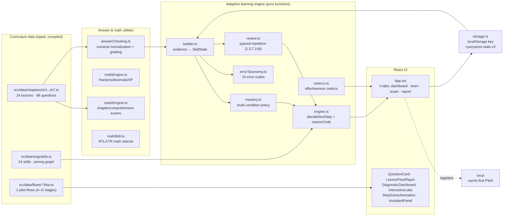

# Architecture — RYAZI-YAR-SIX

> ریاضی‌یار ششم is a static single-page application: after the build, everything
> is static HTML/CSS/JS. There is **no server, no database, and no outbound data
> transfer**. This design buys three things at once:
>
> 1. **Child privacy** — learner progress lives only in the device's `localStorage`.
> 2. **Simple, free hosting** — any static host works (GitHub Pages, Vercel, Netlify).
> 3. **Offline capability** — a hand-written service worker keeps the app usable offline.

## System overview



## Layers

| Layer | Path | Responsibility |
|---|---|---|
| Curriculum data | `src/data/chapters/*.ts` | Typed chapters: lesson pages, worked examples, questions, per-option misconception diagnoses |
| Flow data | `src/data/flows/*.flow.ts` | Multi-stage instructional flows (A–G + X) for the 2 pilot lessons; stage pass rules, remedial loops, solver animations |
| Skill registry | `src/learning/skills.ts` | 24 measurable skills (1 per lesson), prerequisite edges, cognitive levels, representations, per-skill mastery threshold |
| Learning engine | `src/learning/{builder,mastery,review,errorTaxonomy,engine,metrics,assistant}.ts` | Pure, rule-based adaptive decisions; every decision carries a human-readable `reason` + machine-readable `reasonCode` |
| Learner state | `src/hooks/useLearnerState.ts` | Bridges engine ↔ UI: records attempts, XP, daily streak, completed lessons, flow progress |
| Answer checking | `src/utils/answerChecking.ts` | Normalizes Persian/Arabic-Indic digits, decimal separators (`.` `٫` `/` `,`), thousands separators; grades MCQ + numeric answers |
| Exam engine | `src/utils/examEngine.ts` | Builds chapter/comprehensive exams, scores, bands, wrong/unanswered extraction |
| Persistence | `src/utils/storage.ts` | Validated load/save in a single localStorage key; JSON export/import; full wipe |
| Interactive components | `src/components/*` | Step-solver animation (reduced-motion aware), SVG group visuals, fraction/coordinate/cylinder/percentage labs, flow player |
| App shell | `src/App.tsx` | Dashboard, Learn, Exam, Report tabs; RTL layout; adaptive next-step surfacing |

## Key design decisions

- **Data, not a CMS.** Educational content is typed TypeScript. The compiler plus
  integrity tests (`tests/curriculumData.test.ts`, `tests/contentGolden.test.ts`)
  guarantee that structurally invalid content breaks the build instead of reaching
  a student.
- **Evidence-derived state.** `SkillState` is always recomputed from the recorded
  attempt list (`AnswerEvidence[]`). Nothing else is authoritative, which makes
  old saved data forward-compatible without migration and makes every adaptive
  decision reproducible from raw evidence.
- **Explainability is part of the contract.** `EngineDecision = { action, reason,
  reasonCode, targetSkillId? }` — the `reason` is shown to learners/parents, the
  `reasonCode` is asserted in tests (`tests/learningEngine.test.ts`,
  `tests/auditEngineScenarios.test.ts`).
- **Grading lives in a pure layer.** Both practice and exam paths call the same
  `isAnswerCorrect()`; unit tests cover it without rendering anything.
- **Relative base (`base: './'`).** The build works unchanged under
  `https://<user>.github.io/RYAZI-YAR-SIX/` or any other subpath.
- **Local fonts.** Vazirmatn is served from `public/fonts` — required for offline
  operation and part of the zero-external-requests guarantee (see
  [PRIVACY.md](PRIVACY.md)).
- **Minimal runtime dependencies.** Only `react`, `react-dom`, `lucide-react`.
  No router, no state library, no analytics SDK.

## Lifecycle of one answer

```
user input (option or number)
  → answerChecking.isAnswerCorrect()      # normalize + grade (pure)
  → useLearnerState.recordAttempt()       # attempt record + XP + streak + error classification
  → saveLearnerState()                    # validated write to localStorage
  → builder/engine recompute              # SkillState from evidence, mastery + review re-evaluated
  → UI feedback (correct/incorrect + reason + remediation hint)
```

## Mastery policy (default, configurable)

| Condition | Default | Purpose |
|---|---|---|
| Independent accuracy ≥ threshold | 0.85 | hint-free evidence only |
| ≥ min independent attempts | 4 | sample-size floor |
| ≥ distinct success profiles | 2 | different question type / difficulty |
| Transfer assessment passed | required | different-looking problem |
| Delayed review passed | required | retention, not just immediate recall |

Review scheduling: simplified Leitner over `[1, 3, 7, 14]` days; hint-free
success advances a stage, hint-assisted success holds, failure drops two stages.

> These numbers are **engineering assumptions**, documented as such in code and
> in [RELEASE_READINESS.md](RELEASE_READINESS.md) — not validated pedagogical
> constants. They are configurable via `MasteryPolicy` for future recalibration.

## PWA / offline

`public/sw.js` (hand-written, no workbox): cache-first for same-origin GETs,
runtime caching of every fetched asset, `activate` purges all caches whose name
differs from the current `CACHE_NAME` (version-bump = invalidation), navigation
fallback to the cached app shell. `public/manifest.webmanifest` is RTL/fa with
maskable icons. Registered only in production builds. See [TESTING.md](TESTING.md)
for the offline test coverage added in this release train.

## Deployment

GitHub Actions: `ci.yml` (typecheck → lint → test → build + hardening steps) on
every push/PR to `main`; `deploy.yml` deploys to GitHub Pages **only on push to
`main`** and runs the full test suite + production build before uploading — a
red build can never reach Pages. The deployed site lives at
`https://aresmaeily2.github.io/RYAZI-YAR-SIX/`.

The Persian original of this document remains in git history
(`docs/ARCHITECTURE.md` before the open-source release train).
